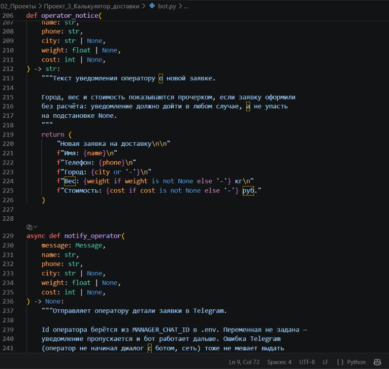
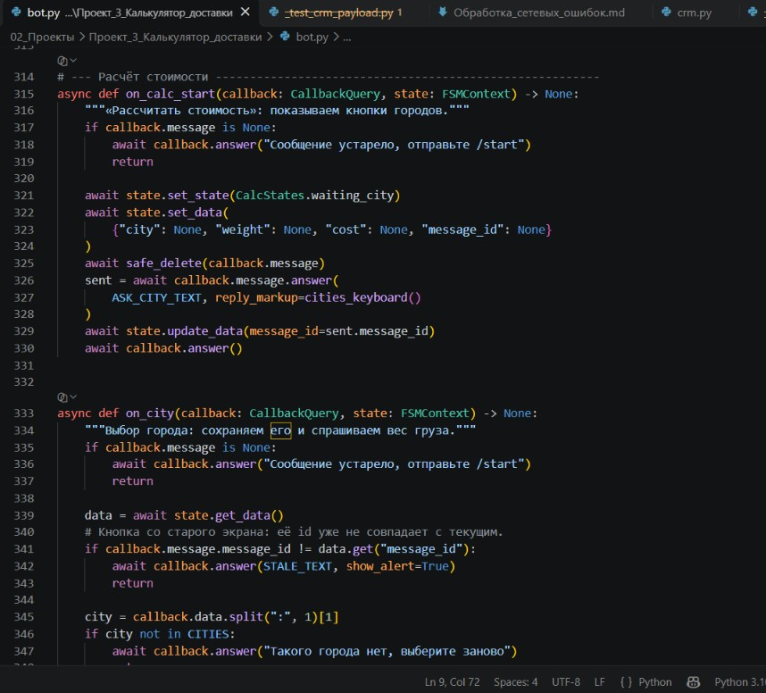

# Проект 3. Telegram-бот «Калькулятор доставки»

Бот [@Delivery_CalcBot](https://t.me/Delivery_CalcBot): считает стоимость
доставки по городу и весу груза, принимает заявку (имя и телефон)
и создаёт сделку в Битрикс24 — с названием «Доставка в Москву»,
суммой в поле сделки и карточкой заявки в комментарии. После
успешной сделки бот присылает оператору сообщение с деталями
заявки.

## Что делает бот (по ТЗ)

- `/start` — приветствие и меню: «Рассчитать стоимость», «Оформить
  заявку», «Связаться с оператором».
- «Рассчитать стоимость»: город из кнопок → вес груза числом →
  стоимость по формуле.
- Под результатом: «Оформить заявку» (сразу с городом и весом)
  или «В главное меню».
- «Оформить заявку»: имя (2-64 символа) → телефон (5-30 символов) →
  заявка в `хранилище/заявки.json` → сделка в Битрикс24 →
  уведомление оператору в Telegram.
- «Связаться с оператором» — кнопка-ссылка на чат оператора
  (`OPERATOR_URL`, в примере — `https://t.me/test_operator`).
- `/reset` сбрасывает любой шаг и возвращает в меню.

## Стек

- Python 3.10, `aiogram` 3.7.0 (FSM на `MemoryStorage`).
- `python-dotenv` — токен бота, вебхук Битрикс24 и прокси из `.env`.
- `requests` — POST-запрос `crm.deal.add.json` в Битрикс24.
- `unittest` — 16 тестов: 11 на расчёт стоимости, 5 на уведомление
  оператору.

## Структура проекта

| Путь | Что лежит |
| --- | --- |
| `bot.py` | сценарий: экраны, машина состояний, вызов CRM |
| `данные/cities.py` | города, надбавки, ставки и `calculate_cost()` |
| `crm.py` | сделка в Битрикс24: название, сумма, контакт, карточка |
| `хранилище/заявки.py` | запись заявок в JSON с защитой от битого файла |
| `хранилище/заявки.json` | заявки (в репозиторий не идут) |
| `тесты/test_расчет.py`, `тесты/test_уведомление.py` | 16 тестов на `unittest` |
| `схема_бота.json` | граф сценария: экраны, события, переходы, состояния |
| `README.md` | описание проекта: сценарий, схема, тесты, демо-сценарий |
| `Медиа/` | скриншоты работы: сделка в Битрикс24 и код бота |

## Запуск (Windows, PowerShell)

```powershell
# 1. Установить зависимости
pip install -r requirements.txt

# 2. Скопировать .env.example в .env и заполнить:
#    BOT_TOKEN          — токен от @BotFather
#    BITRIX_WEBHOOK_URL — входящий вебхук Битрикс24 (.../rest/1/xxxx/)
#    MANAGER_CHAT_ID    — Telegram-id оператора для уведомлений
#    PROXY_URL          — только если api.telegram.org недоступен напрямую

python bot.py
```

Если вебхук не заполнен, бот продолжает работать: заявка пишется
в JSON, а в консоль уходит `[CRM MOCK] URL вебхука не задан`.
Имя переменной — `BITRIX_WEBHOOK_URL`; старое `BITRIX_WEBHOOK`
читается как запасное, поэтому уже заполненный `.env` работает
без правок.

## Расчёт стоимости

Формула из ТЗ: `стоимость = базовая ставка + вес × цена за кг +
надбавка города`.

| Город | Надбавка |
| --- | --- |
| Москва | 500 руб. |
| Санкт-Петербург | 300 руб. |
| Новосибирск | 200 руб. |
| Екатеринбург | 150 руб. |

Базовая ставка — 500 руб., цена за килограмм — 100 руб. Вес принимается
от 0.1 до 10 000 кг, запятая как разделитель тоже подходит («12,5»).
Например, Москва и 12.5 кг: 500 + 1250 + 500 = 2250 руб.

## Тесты

```powershell
python -m unittest discover -s тесты -v
```

16 тестов. `test_расчет.py` (11): формула для каждого города, границы
веса (0.1 и 10 000 кг), целые рубли, рост цены ровно на 100 руб. за
килограмм, ошибка на неизвестный город. `test_уведомление.py` (5):
текст уведомления с полями заявки и с прочерками без расчёта,
отправка на `MANAGER_CHAT_ID`, пропуск без него, `False` от CRM
без вебхука. Telegram и сеть подменены заглушками — тесты идут
без токена и без сети.


## Схема бота

Граф сценария лежит в `схема_бота.json`: 11 экранов (приветствие,
выбор города, ввод веса, результат, имя, телефон, уведомление
оператору, благодарность, экран ошибки записи, устаревшая кнопка,
служебная сделка в CRM), 16 переходов, 4 FSM-состояния, 6 точек
выхода.

Главный путь: `/start` → «Рассчитать стоимость» → город → вес →
результат → «Оформить заявку» → имя → телефон → «Спасибо, <имя>!
Ваша заявка принята» → сделка в Битрикс24 → уведомление оператору.

Особенности:

- защита от старых кнопок: сверка `message_id` активного экрана,
  на устаревшей кнопке всплывает «Эта кнопка устарела»;
- город, вес и стоимость остаются в FSM после расчёта, поэтому заявка
  под результатом уходит в CRM уже с суммой;
- `/start` и `/reset` прерывают расчёт и форму из любого шага, команда
  не попадает в поле.

## Передача в Битрикс24

`crm.send_lead_to_bitrix()` отправляет POST на входящий вебхук
методом `crm.deal.add.json` и создаёт сделку:

| Поле сделки | Что внутри |
| --- | --- |
| `TITLE` | «Доставка в Москву» — город в винительном падеже (словарь `PADEZH`), без расчёта — «Новая заявка на доставку» |
| `OPPORTUNITY` | рассчитанная стоимость, она же сумма на экране результата |
| `NAME`, `PHONE` | имя и телефон из формы |
| `COMMENTS` | карточка заявки: имя, телефон, город, вес |

Ошибки сети и отказы сервера бот не роняют: статус ответа и текст
ошибки печатаются в консоль. Запросы идут мимо системного прокси
(`trust_env = False` и явные `proxies=None`), иначе они падают
за VPN.

## Уведомление оператору

После успешной сделки (`send_lead_to_bitrix()` вернул `True`) бот
отправляет оператору карточку заявки:

```
Новая заявка на доставку

Имя: Иван
Телефон: +7 900 000-00-00
Город: Москва
Вес: 12.5 кг
Стоимость: 2250 руб.
```

- Адрес — `MANAGER_CHAT_ID` из `.env` (свой id показывает @userinfobot).
- Оператору нужно один раз нажать `/start` у бота: первым писать
  Telegram не даёт, иначе уведомление не уходит (причина в логе).
- Переменная не задана — уведомление пропускается, в лог уходит
  `MANAGER_CHAT_ID не задан: уведомление оператору пропущено`.
- Город, вес и стоимость без расчёта показываются прочерком.
- Оператор не начинал диалог или упала сеть — заявка всё равно
  сохранена и передана в CRM, а причина пишется в лог: клиент не
  должен видеть ошибку из-за уведомления.

## Скриншоты работы

Сделка в Битрикс24: название с городом, сумма из расчёта, карточка заявки
в сделке.


Код бота — расчёт стоимости, состояния формы и защита от старых кнопок:





## Что показать на демо

Сценарий для видео (2-3 минуты):

1. `/start` — приветствие и меню из трёх пунктов.
2. «Рассчитать стоимость» → Москва → вес `12.5` — результат
   2250 руб.
3. Показать ошибку ввода: вес `abc` и вес `0` — бот просит число
   от 0.1 до 10 000 кг.
4. Под результатом нажать «Оформить заявку»: имя, телефон
   (сначала короткий телефон `123` — ошибка, затем нормальный).
5. «Спасибо, <имя>! Ваша заявка принята».
6. В консоли бота: `[CRM] Статус ответа: 200` и
   `[CRM] Ответ Битрикс24: {"result": <id сделки>}`.
7. Открыть чат с ботом под аккаунтом оператора: пришло сообщение
   «Новая заявка на доставку» с именем, телефоном, городом, весом
   и стоимостью.
8. Переключиться в Битрикс24: сделка «Доставка в Москву», сумма
   2250, в комментарии карточка заявки (имя, телефон, город, вес).
9. Оформить заявку без расчёта (сразу из меню) — сделка
   «Новая заявка на доставку» с суммой 0: видно, что бот не пишет
   «Доставка в None», а в уведомлении стоят прочерки.
10. `/reset` посреди формы — бот вернулся в меню, незаконченная
    заявка не сохранилась.

## Артефакты проекта

| Артефакт | Файл | Статус |
| --- | --- | --- |
| Код бота | `bot.py`, `данные/`, `crm.py`, `хранилище/` | Готов |
| Схема | `схема_бота.json` | Готова: 11 экранов, 16 переходов, 6 выходов |
| Тесты | `тесты/test_расчет.py`, `тесты/test_уведомление.py` | Готовы: 16 тестов, все зелёные |
| Документация | `README.md` | Готова |
| Скриншоты | `Медиа/` | Сделка в Битрикс24 и код бота; чат и JSON ждут пересъёмки |
| Видео-демонстрация | — | Не записана |
| Публикация на GitHub | `delivery-calc-bot` | Опубликован 25.11.2026: https://github.com/Lilys70/delivery-calc-bot |

## Решённые вопросы

- Название сделки: город в винительном падеже через словарь `PADEZH`,
  иначе в Битрикс24 приходило «Доставка в Москва».
- Сумма и карточка заявки: стоимость уходит в `OPPORTUNITY`, а имя
  и телефон дублируются текстом в `COMMENTS` — поля `NAME` и `PHONE`
  относятся к контакту и на карточке сделки могут не отображаться.
- Заявка без расчёта: нейтральное название и 0 руб. вместо
  «Доставка в None».
- `requests` не видит системный прокси: без `trust_env = False`
  запрос к Битрикс24 падал за прокси и VPN.
- Уведомление оператору: уходит после успешного ответа Битрикс24,
  поэтому за одну заявку не дублируется; без `MANAGER_CHAT_ID`
  пропускается молча и не мешает заявке.
- Кнопка «Связаться с оператором» ведёт на ник из константы
  `OPERATOR_URL`; в примере стоит заглушка `https://t.me/test_operator`,
  в рабочей версии — живой ник оператора.

## Открытые вопросы

- Записать видео-демонстрацию.

## Правила безопасности

- Токен, вебхук, id оператора и прокси — только в `.env`, файл
  в `.gitignore`.
- `хранилище/заявки.json` — персональные данные, в репозиторий не идёт.
- Учебные материалы Zerocoder (`_Документы/`, ТЗ, тетрадь) в репозиторий
  не входят.
- В коде и репозитории нет токенов и ключей.
